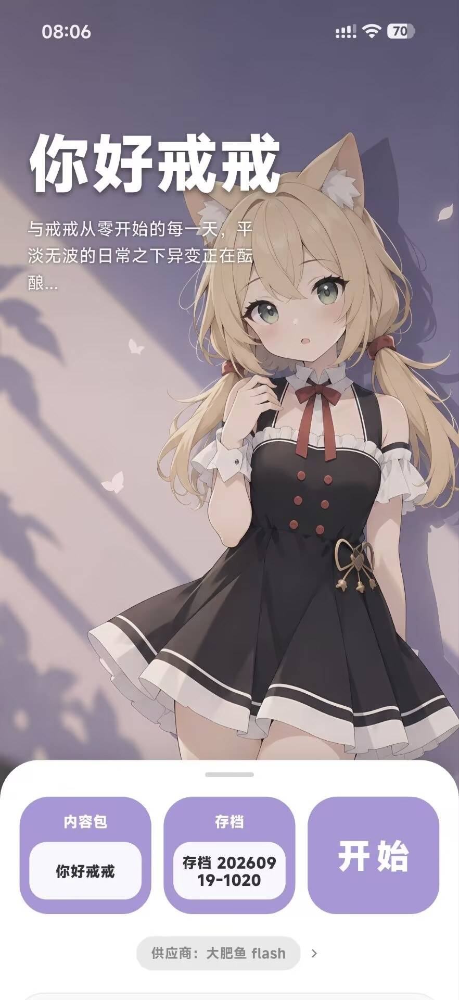
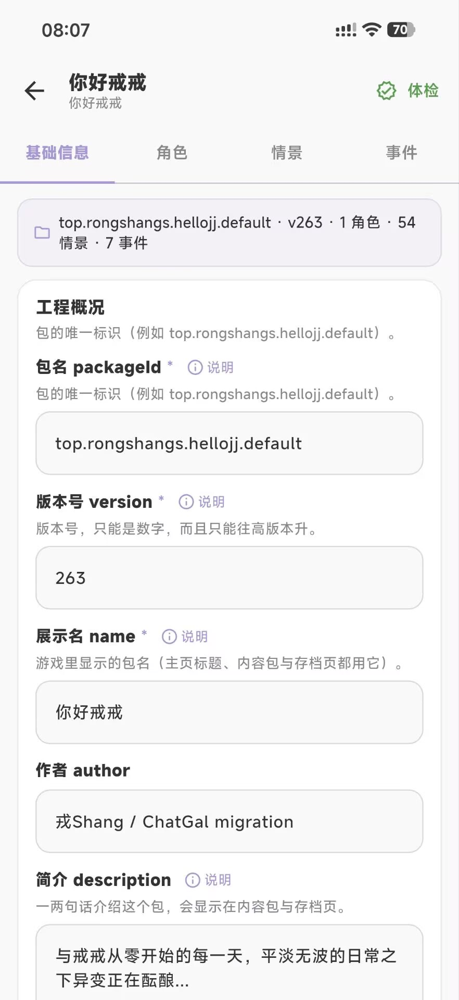
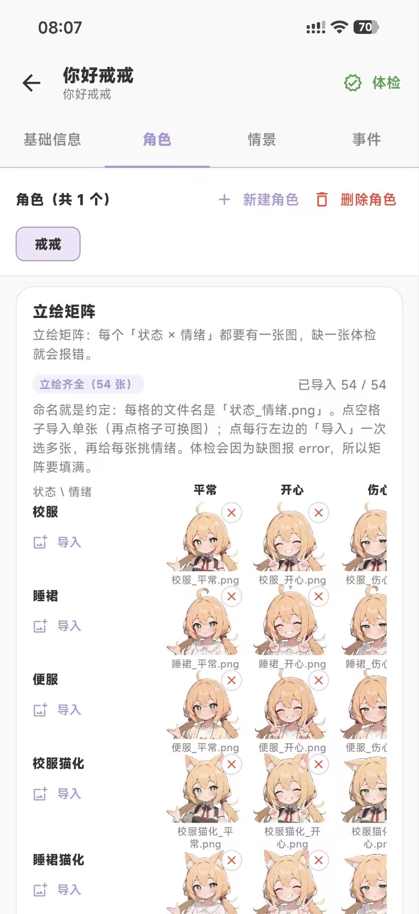
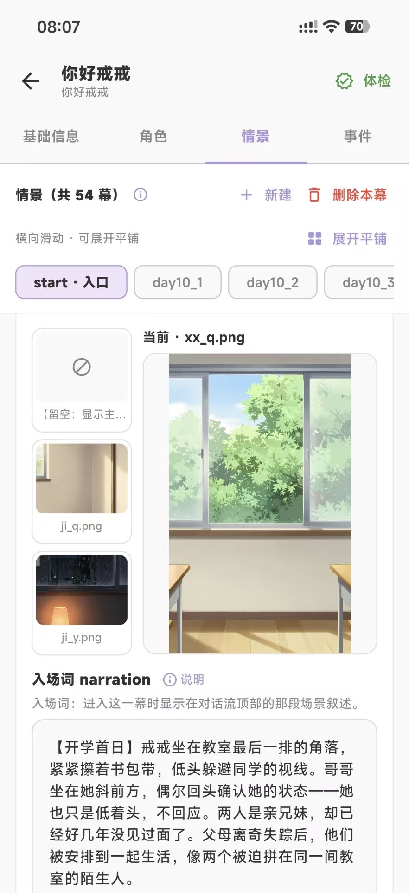
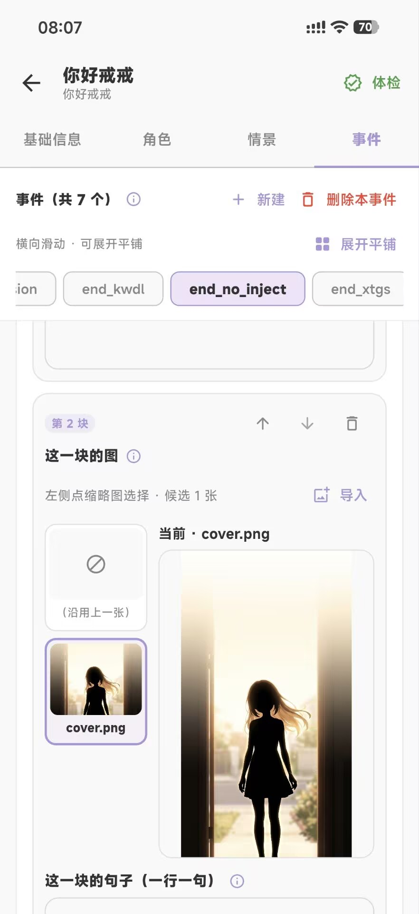

<div align="center">


# ChatGal

### 写自己的故事，也走进别人的故事。

内容包驱动的 AI 互动 Gal · Android 客户端 · 内置内容包创作台

[](LICENSE)
[](https://github.com/RongShangs/ChatGal/releases/latest)
[](docs/BUILD.md)
[](apps/chatgal)

**[下载 APK](https://github.com/RongShangs/ChatGal/releases/latest) · [访问官网](https://chatgal.rongshangs.top) · [下载源码](https://github.com/RongShangs/ChatGal/archive/refs/tags/v0.1.6-source.zip) · [创作指南](docs/AUTHOR_GUIDE.md)**

</div>

ChatGal 是一款基于 Flutter 的 **AI 互动 Gal 客户端与内容创作工具**。你可以选择故事包，通过对话推进剧情；也可以在手机上的创作台中设计角色、编排情景、导入立绘，让自己的故事变成可安装、可分享的 `.chatgal` 内容包。

角色、情景、变量、立绘、事件与结局由内容包定义。客户端提供对话、记忆、结算、存档与编辑能力，供不同的故事复用。

本仓库已按 **GNU GPL v3.0（GPL-3.0-only）** 完整开源：包括 Flutter 应用、三个核心 Dart 包、两个内置内容包的全部源文件与素材、测试、Schema、构建工具及文档。

**快速导航：** [界面预览](#界面预览) · [功能与设计](#功能与设计) · [开始游玩](#开始游玩) · [制作内容包](#制作内容包) · [开发与构建](#开发与构建) · [常见问题](#常见问题) · [文档与交流](#文档与交流)

## 界面预览

### 故事从主页开始

选择内容包、切换存档，进入你想继续的故事。

<p align="center">
  
</p>

<p align="center"><sub>「你好戒戒」示例内容包主页</sub></p>

### 四个页面，组织一个故事

创作台按基础信息、角色、情景和事件分区。图片可点击查看原图。

<table>
  <tr>
    <th width="50%" align="center">01 · 基础信息</th>
    <th width="50%" align="center">02 · 角色与立绘</th>
  </tr>
  <tr>
    <td width="50%" align="center" valign="top">
      <br />
      <sub>包信息、主页图与变量</sub>
    </td>
    <td width="50%" align="center" valign="top">
      <br />
      <sub>角色设定与状态 × 情绪立绘</sub>
    </td>
  </tr>
  <tr>
    <th width="50%" align="center">03 · 情景编辑</th>
    <th width="50%" align="center">04 · 事件编辑</th>
  </tr>
  <tr>
    <td width="50%" align="center" valign="top">
      <br />
      <sub>背景、入场词、场景规则与出口</sub>
    </td>
    <td width="50%" align="center" valign="top">
      <br />
      <sub>事件图文、结局与选择题分支</sub>
    </td>
  </tr>
</table>

> 五张截图由维护者提供，展示「你好戒戒」内容包及创作台。截图中的内容版本为 v263，当前源码内置默认包为 v264。

## 功能与设计

### 面向玩家

| 能力 | 体验 |
| --- | --- |
| AI 对话 | 使用自己配置的 OpenAI 兼容接口，根据角色设定、情景与记忆生成对白；支持流式输出 |
| 立绘与快捷回复 | 独立 agent 为每轮对白选择表情与立绘，并提供两条玩家视角的快捷回复 |
| 剧情推进 | 情景包含入场词、场景提示、变量规则与出口，满足条件时进入下一幕或事件 |
| 分支与结局 | 条件出口、事件图文与选择题共同组织故事；示例包包含主线与无尽分支 |
| 记忆回廊 | 五层记忆与关键词辅助长期对话；多角色的记忆按角色隔离，可查看关键词条目 |
| 存档管理 | 按内容包隔离、多档保存、改名、复制及导入导出；无法读取的旧档仍会保留并提示 |
| 画面与声音 | 可调整画面、字体和记忆配置；云端 TTS 需自行配置语音服务 |

正文完成后就可以继续发送下一句；立绘与快捷回复单独更新，快捷回复在 agent 就绪后启用。换场时会显示记忆提炼与离场结算的进度及等待时间。

### 面向内容作者

- **在手机上创作**：编辑包信息、角色、情景与事件，导入和预览图片。
- **角色与素材分离**：角色定义人格、状态与情绪，立绘按「状态 × 情绪」组织。
- **显式控制故事规则**：声明变量、设置上下限，使用入场效果、离场结算与条件出口控制推进。
- **结构体检后分享**：创作台、安装流程与打包工具共用内容包校验能力；导出 `.chatgal` 后即可传给他人。
- **支持文本创作**：JSONC 可写注释与尾逗号；内容作者无需编写 Dart 代码。

### 对话、规则与记忆如何配合

1. **内容包提供舞台**：角色人格、当前情景、在场角色与变量组成故事的初始状态。
2. **AI 生成对白**：结合当前情景和角色记忆响应玩家，立绘 agent 负责选择本轮表情与推荐回复。
3. **规则决定推进**：注册变量由内容包规则与离场结算共同控制，模型的文字不会直接成为任意数值修改。
4. **离场时整理与结算**：提炼本幕记忆，按证据结算变量，再根据出口条件进入下一幕、事件或主页。
5. **更高层记忆在后台整理**：L1 → L5 的分层记忆与关键词帮助角色延续认知，减少长期对话的上下文负担。

完整支持范围与已知问题见 [SUPPORT.md](docs/SUPPORT.md)，分层边界见 [BOUNDARY.md](docs/BOUNDARY.md)。

## 开始游玩

1. **安装应用**：从 [GitHub Releases](https://github.com/RongShangs/ChatGal/releases/latest) 或 [官网](https://chatgal.rongshangs.top) 下载 Android arm64 APK。
2. **配置模型**：进入「设置 → 模型供应商」，填写兼容接口地址、模型名及服务所需的 Key。
3. **选择故事**：在主页选择内置内容包，开始新游戏或继续存档。
4. **扩展内容**：在「内容包与存档」安装其它 `.chatgal` 文件，或从创作台制作自己的包。

模型服务与云端 TTS 的使用额度由你配置的服务商提供。存档和设置保存在设备本地；调用服务时，相关对话或朗读文本会发送至你配置的接口。详情见 [隐私政策](https://rongshangs.github.io/chatgal_privacy/)。

### 两个内置故事

| 内容包 | 你好戒戒 | 与戒戒的每一天 |
| --- | --- | --- |
| 体验 | 十四天主线，在日常与变化中走向不同分支，并可进入结局后的无尽日常 | 上学、外出、回家组成的轻松日常循环 |
| 规模 | 1 角色 · 54 幕 · 7 事件 | 1 角色 · 3 幕 · 0 事件 |
| 当前版本 | v264 | v9 |
| 适合 | 体验完整示例，学习条件出口、事件与结局 | 初次上手，学习最基本的内容包结构 |
| 内容源 | [content/default_v2](content/default_v2) | [content/daily_v2](content/daily_v2) |
| 独立下载 | [hellojj_default.chatgal](packs/hellojj_default.chatgal) | [hellojj_daily.chatgal](packs/hellojj_daily.chatgal) |

这些故事是引擎的示例。你可以参考它们的结构，创作自己的角色与世界。

## 制作内容包

### 在应用内完成

**新建工程 → 填写基础信息 → 配置角色与立绘 → 编排情景和事件 → 体检 → 导出分享。**

角色、情景与事件各自编辑，背景和立绘可从图片导入。情景负责常规对话，事件适合图文演出、结局展示和选择题分支。

### 从文件开始

`.chatgal` 是一个 ZIP 容器，顶层直接放包内容。最小结构如下：

```text
my_story/
├─ manifest.json                 包信息、版本与变量注册
├─ home.png                      主页封面
├─ characters/
│  └─ 角色名/
│     ├─ character.json          人格、状态、情绪与默认值
│     └─ 状态_情绪.png           每个状态 × 情绪组合对应一张立绘
├─ stories/
│  ├─ start.json                 固定入口
│  ├─ next_scene.json            后续情景与出口
│  └─ background.png             背景图片
└─ events/
   └─ ending/
      ├─ event.json              图文内容及出口或选择题
      └─ cover.png               事件图片
```

JSON 支持 `//`、`/* */` 注释与尾逗号。情景 id 来自文件名，角色 id 和事件 id 来自目录名。立绘需要覆盖角色声明的全部状态与情绪组合，导出后可通过体检检查引用和结构。

从 [最小示例](examples/min_pack) 开始，或参考 [选择题事件示例](examples/demo_choice_pack)。具体字段、条件表达式和完整规则见 [内容包作者指南](docs/AUTHOR_GUIDE.md)。

## 开发与构建

当前应用 **v0.1.6+7**，首发平台为 **Android arm64**。已使用 Flutter **3.47.2 stable**、Dart **3.13.2**、JDK **17** 和 Android SDK；Python 3 用于内容打包。

### 构建 APK

```sh
git clone https://github.com/RongShangs/ChatGal.git
cd ChatGal/apps/chatgal
flutter pub get
flutter build apk --release --target-platform android-arm64
```

输出：`apps/chatgal/build/app/outputs/flutter-apk/app-release.apk`。

仓库已包含 Gradle Wrapper、内置内容包和全部内容源，普通构建无需仓库外文件或历史 Fusion 工程。依赖准备、测试及签名配置见 [构建指南](docs/BUILD.md)。当前 release 构建沿用 debug 签名；自行构建的 APK 不保证可以覆盖官方 APK，安装前请先导出存档。

### 修改与打包内容

先在 `packages/gal_protocol` 执行 `dart pub get`，再从仓库根目录运行：

```sh
python tools/pack_default_v2.py
```

工具会体检并重建默认包和教学包。默认剧情的生成源为 `tools/legacy_content.json` 与 `tools/rebuild_default_v2_demo.py`；教学包可直接编辑 `content/daily_v2/`。内容变更需要同步包版本，详见构建指南。

### 代码分层

```text
apps/chatgal/            Flutter 客户端、创作台与应用测试
packages/gal_protocol/   内容包/存档契约、模型、表达式与结构校验
packages/gal_ai/         对话 provider、立绘 agent、记忆与结算事务
packages/gal_storage/    包安装导出、存档及创作工程持久化
content/                两个内置内容包的源文件与素材
packs/                  可直接下载安装的内容包
examples/               最小包与选择题示例
schemas/v2/             JSON Schema 与协议说明
tools/                  打包、内容重建、迁移工具与文本数据
docs/                   作者指南、架构、构建、支持范围与截图
```

依赖方向为 `apps/chatgal → gal_storage / gal_ai → gal_protocol`。应用负责界面，协议包定义契约，AI 包处理对话与事务，存储包负责安装和持久化。

本次开源已从独立副本完成内容重建、两包体检与确定性打包、相关单文件测试、静态分析及 Android release 构建。详细结果与验证边界见 [开源记录](docs/OPEN_SOURCE.md)。

## 常见问题

**需要自己配置模型吗？**

需要。应用支持 OpenAI 兼容接口；未配置时可通过 Mock 路径体验界面与流程，真实 AI 对话需要可用的模型服务。

**可以使用本地模型吗？**

可以连接独立本地推理服务提供的兼容接口。主应用不内置模型权重或推理运行时，历史实验与接入说明见 [推理引擎文档](docs/推理引擎.md)。

**写故事需要会编程吗？**

可直接使用应用内创作台。文件创作使用 JSONC 配置和图片，内容包作者无需编写 Dart；条件出口与变量规则可以参考内置示例。

**支持 iOS、云同步或 Live2D 吗？**

当前只声明 Android 支持，iOS 未验证；未内置账号、云同步、在线工坊后端或 Live2D。工坊入口通过系统浏览器打开站点。

**为什么旧存档会显示打不开？**

当前开发版只读取支持的存档结构。更旧、损坏或缺少内容包的存档会显示提示并保留原文件；升级前建议导出备份。

## 文档与交流

| 我想…… | 从这里开始 |
| --- | --- |
| 编写与分享故事 | [内容包作者指南](docs/AUTHOR_GUIDE.md) |
| 编译、测试与打包 | [构建指南](docs/BUILD.md) |
| 确认某项能力是否可用 | [支持范围与已知问题](docs/SUPPORT.md) |
| 理解架构和职责 | [分层边界](docs/BOUNDARY.md) · [架构决策](docs/adr/0001-monorepo-and-authority.md) |
| 查字段与格式 | [Schema 与协议](schemas/v2/README.md) |
| 参与代码或文档改进 | [贡献指南](CONTRIBUTING.md) · [提交 Issue](https://github.com/RongShangs/ChatGal/issues) |
| 了解本次开源 | [开源发布记录](docs/OPEN_SOURCE.md) · [v0.1.6 完整源码](https://github.com/RongShangs/ChatGal/tree/v0.1.6-source) |

反馈问题时，请附应用版本、复现步骤及去除 Key 和聊天隐私后的日志。欢迎提交代码、内容工具和文档方面的改进。

**QQ 交流群：`1054545834`** · [支持作者](https://afdian.com/a/rongshang) · [作者博客](https://rongshangs.top/) · [隐私政策](https://rongshangs.github.io/chatgal_privacy/)

## 许可证

本项目自有代码与内容采用 **GNU General Public License v3.0 only**（SPDX：`GPL-3.0-only`），完整条款见 [LICENSE](LICENSE)。分发修改版时，请遵守 GPLv3 关于许可证、修改说明与对应源码的要求。

站酷快乐体沿用 **SIL Open Font License 1.1**，Gradle Wrapper 沿用 **Apache License 2.0**；第三方代码与素材的原有许可继续适用，详见 [THIRD_PARTY_NOTICES.md](THIRD_PARTY_NOTICES.md)。
